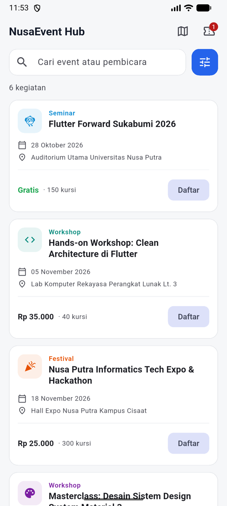
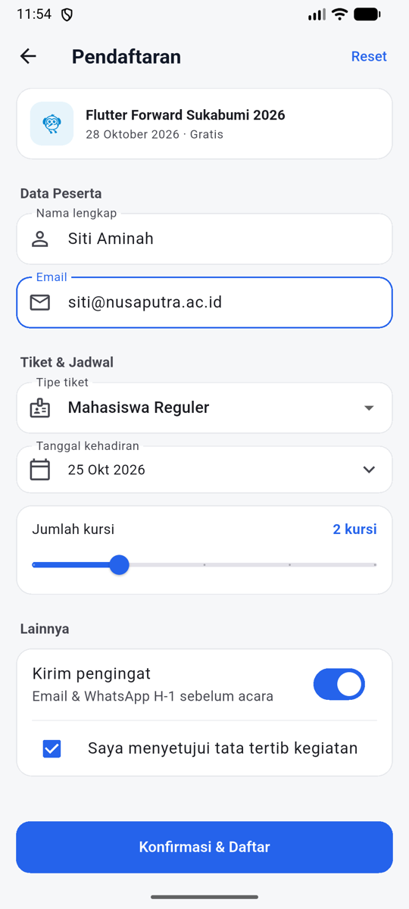
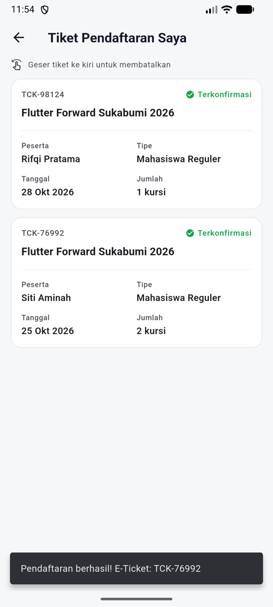
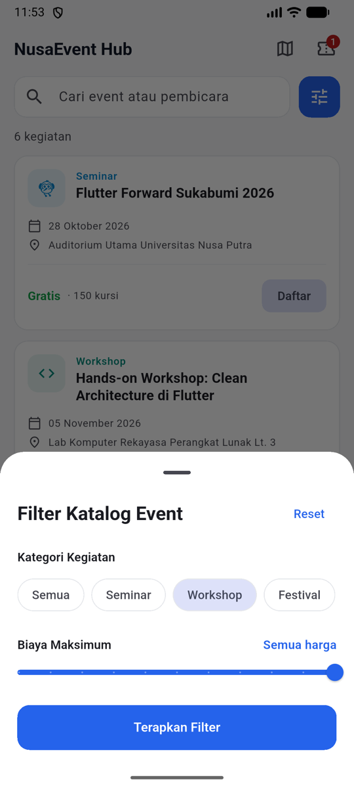
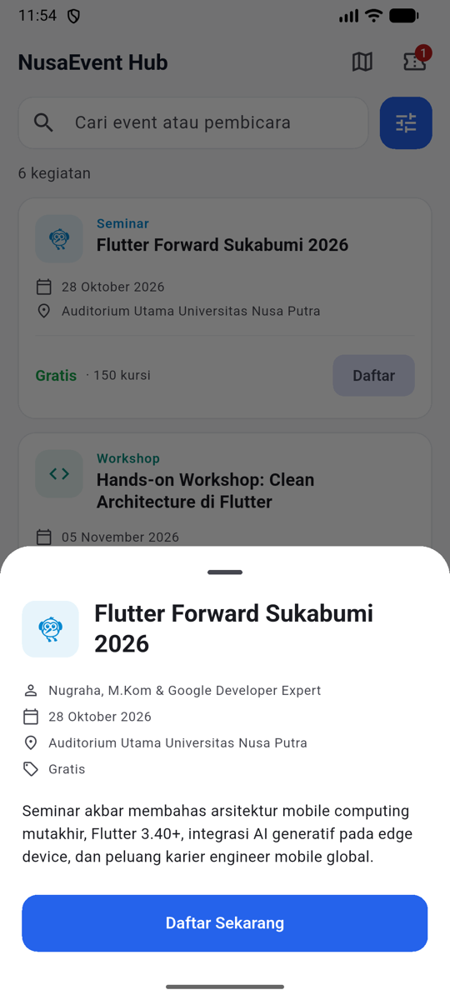
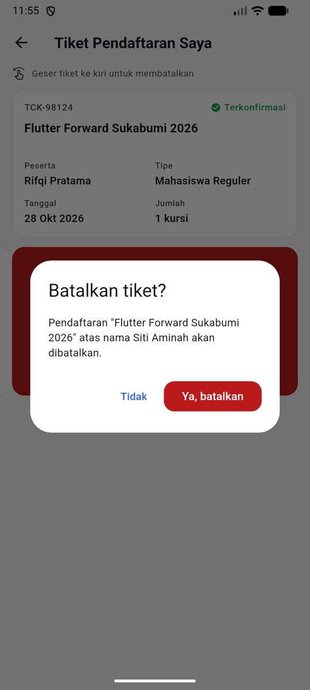
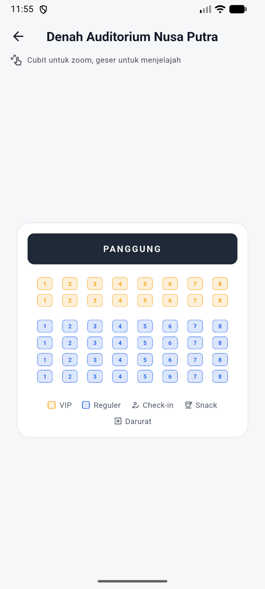
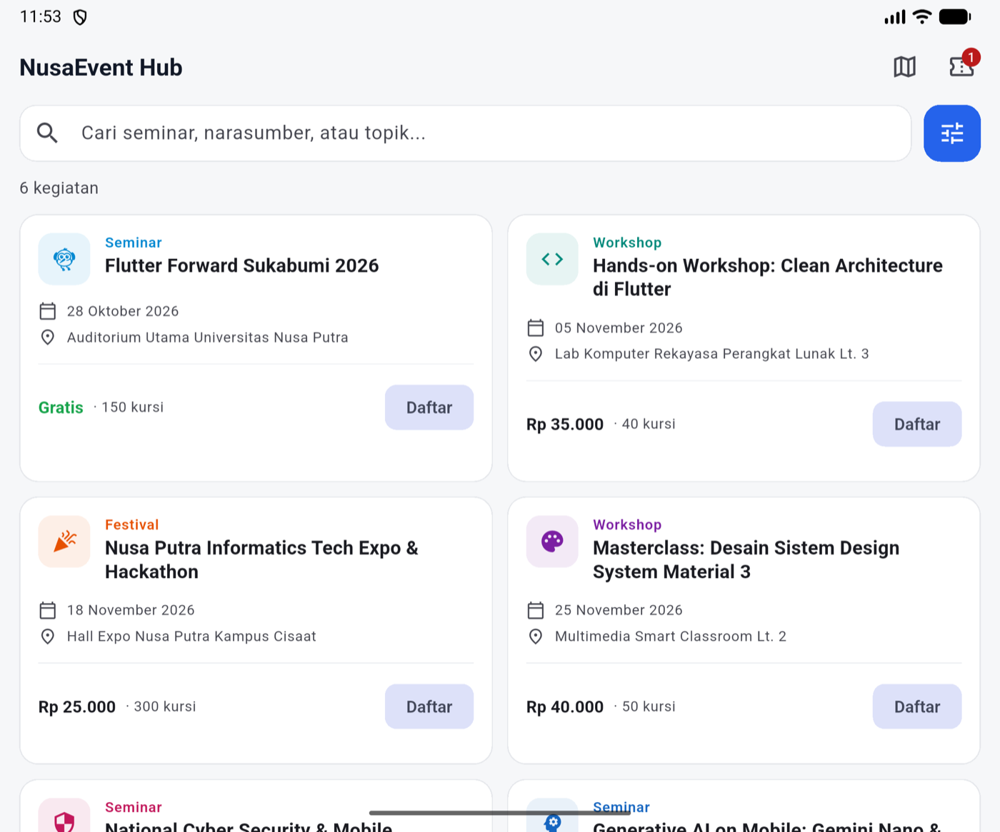

# NusaEvent Hub — Sesi 5: Membangun UI Interaktif

Aplikasi Flutter (Material 3) untuk praktikum **Pemrograman Perangkat Mobile (IF31033)**, Universitas Nusa Putra.
Katalog seminar & workshop kampus. Setiap layar mendemonstrasikan satu konsep UI interaktif.

<p>
  
  
  
</p>

---

## Isi Aplikasi

| Layar | Tampilan | Konsep yang dipelajari |
|---|---|---|
| **Beranda** — daftar event, pencarian, badge jumlah tiket |  | `ListView.separated`, `TextField`, `Badge`, `InkWell` |
| **Filter** — kategori & batas harga |  | `showModalBottomSheet`, `ChoiceChip`, `Slider` |
| **Detail event** — tap kartu event |  | Bottom sheet dengan `showDragHandle` |
| **Formulir pendaftaran** — validasi input |  | `Form` + `GlobalKey<FormState>`, `TextFormField` + validator (regex email), `DropdownButtonFormField`, `showDatePicker`, `Slider`, `SwitchListTile`, `CheckboxListTile` |
| **Tiket saya** — hasil pendaftaran |  | Mengirim data balik dengan `Navigator.pop(context, result)`, `SnackBar` |
| **Batalkan tiket** — geser kiri |  | `Dismissible` + `confirmDismiss` (`AlertDialog`) |
| **Denah venue** — cubit untuk zoom |  | `InteractiveViewer` (skala 0.6× – 3.5×) |

### Tata letak responsif (tablet / layar lebar)

`LayoutBuilder` mengganti daftar 1 kolom menjadi `GridView.builder` 2 kolom saat lebar layar **≥ 650 dp**.



### Alur pengguna

```text
Beranda ──tap kartu──▶ Detail ──Daftar──▶ Formulir ──Konfirmasi──▶ Beranda (+1 tiket)
   │                                                                     │
   ├──ikon filter──▶ Filter (bottom sheet)                               │
   ├──ikon peta───▶ Denah venue (pinch-to-zoom)                          │
   └──ikon tiket──▶ Tiket saya ──geser kiri──▶ Konfirmasi batal ◀────────┘
```

---

## Menjalankan dengan FVM

Proyek ini dikunci ke **Flutter 3.41.8** (Dart 3.11.5) lewat [`.fvmrc`](.fvmrc).

```bash
fvm install
```

```bash
fvm flutter pub get
```

```bash
fvm flutter run
```

Cek kualitas kode & jalankan test:

```bash
fvm flutter analyze
```

```bash
fvm flutter test
```

> **VS Code / Android Studio:** arahkan Flutter SDK ke `.fvm/flutter_sdk` di folder proyek.

---

## Struktur Folder

```text
lib/
├── main.dart                          # Entry point + tema (satu warna utama, kartu flat)
├── data/sample_events.dart            # Data dummy 6 event
├── models/
│   ├── event_item.dart                # Model event
│   └── registration_ticket.dart       # Model tiket
├── screens/
│   ├── home_events_screen.dart        # Beranda responsif + detail event
│   ├── event_registration_screen.dart # Formulir dengan validasi
│   └── registered_tickets_screen.dart # Daftar tiket + swipe-to-dismiss
├── utils/formatters.dart              # Format Rupiah & tanggal
└── widgets/
    ├── event_card.dart                # Kartu event
    ├── filter_bottom_sheet.dart       # Bottom sheet filter
    └── venue_map_viewer.dart          # Denah dengan InteractiveViewer
test/widget_test.dart                  # 5 widget test
screenshots/                           # Gambar untuk README ini
```

---

## Latihan Flutter Inspector

1. Jalankan `fvm flutter run`, lalu buka **Flutter DevTools → Flutter Inspector**.
2. Aktifkan **Select Widget Mode**, lalu klik kartu event di layar.
3. Buka **Layout Explorer** pada `Row` di bagian bawah kartu untuk melihat `Expanded` dan constraints.
